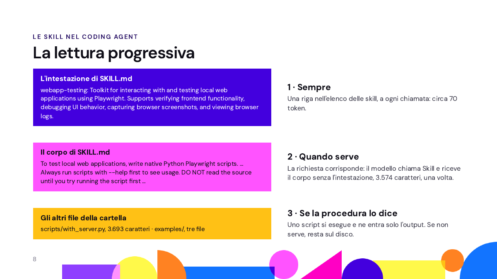
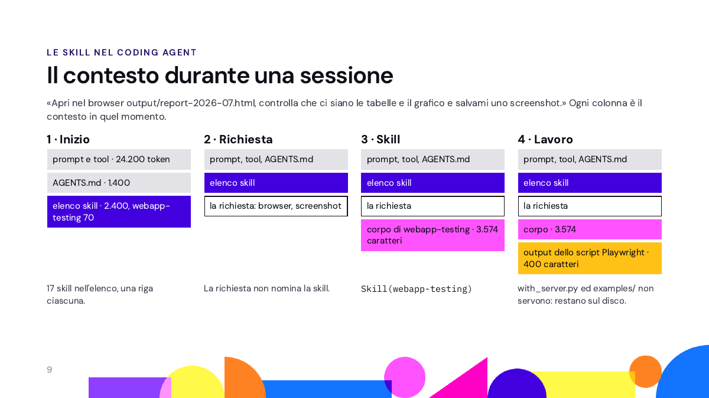

# Modulo 4 · Lezione 7: skill, istruzioni che l'agente carica quando servono

Una skill è una procedura scritta in un file, `SKILL.md`, che l'agente legge
solo quando gli serve. Oggi vedete cosa sa il modello di una skill prima di
aprirla, il nome e la descrizione, e come da quelli decide se aprirla; poi ne
scrivete una per il progetto Valtesa, il report mensile delle note spese, e la
fate usare al coding agent. In fondo, la stessa idea costruita a mano
nell'assistente, con l'Agents SDK.

## Preparare la cartella

All'inizio della lezione, dalla radice della vostra copia della repo del corso
(la cartella che contiene `modulo4-agenti/`):

```bash
git switch main
git pull
git switch -c l07-lavoro
```

Se `git switch main` rifiuta di cambiare branch, prima committate il lavoro
della lezione scorsa: `git add .` e `git commit -m "lavoro della lezione scorsa"`.

## Preparare l'ambiente

Sempre dalla radice della repo:

```bash
cd modulo4-agenti/l07_skill/scripts/working
source ../../../.venv/bin/activate
cp ../../../l06_lab-assistente-su-cartella/scripts/working/.env .env
pytest
```

Su PowerShell il venv si attiva con `..\..\..\.venv\Scripts\Activate.ps1` e
la chiave si copia con
`copy ..\..\..\l06_lab-assistente-su-cartella\scripts\working\.env .env`. Se
la cartella della lezione scorsa non ha il `.env`: copiate `.env.example` in
`.env` e incollate la chiave del corso dopo `OPENAI_API_KEY=`.

`pytest` deve dire `85 passed` (su Windows senza i permessi per i link
simbolici: `84 passed, 1 skipped`). I test non chiamano le API. Per
l'esercizio non c'è niente da installare.

## I file della lezione

| File | A cosa serve |
|---|---|
| `working/` | il progetto Valtesa: la soluzione del docente di Modulo 4 · Lezione 6 |
| `working/AGENTS.md` | le istruzioni per il coding agent; le regole del lab non ci sono più |
| `working/report.py` | il report HTML di un mese, da Modulo 4 · Lezione 3: `python report.py 2026-07` |
| `working/dati/export-ottobre.csv` | l'ultimo export arrivato dal gestionale |
| `working/specifica-skill.md` | la specifica della skill dell'esercizio: la descrizione e i criteri li scrivete voi |
| `working/skill_agente.py` | la lettura progressiva costruita nell'assistente: l'indice nelle istruzioni, il corpo con `apri_skill` |
| `working/skill-assistente/rimborso-trasferta/` | la skill dell'assistente usata da `skill_agente.py` |
| `ripartenza/.claude/skills/report-mensile/` | la skill del docente, per chi si ferma |

`tests/test_regole.py` e `guasti.md` del lab non ci sono più: le regole del
lab valevano per il lab.

## Cos'è una skill

La definizione di Anthropic, che ha introdotto il formato:

> Agent Skills are modular capabilities that extend Claude's functionality.
> Each Skill packages instructions, metadata, and optional resources (scripts,
> templates) that Claude uses automatically when relevant.

Una skill è una capacità in più per l'agente: istruzioni, metadati e, se
servono, risorse come script e modelli, che l'agente usa da solo quando la
richiesta la chiede. I tre ingredienti:

- **le istruzioni**: come si fa il lavoro, passo per passo;
- **i metadati**: nome e descrizione, cioè cosa fa la skill e quando usarla;
- **le risorse**: script da eseguire, modelli e documenti da leggere se
  servono.

Fonte: la pagina «Agent Skills» della documentazione di Anthropic,
<https://platform.claude.com/docs/en/agents-and-tools/agent-skills/overview>.

## Le skill nella prima chiamata

In Modulo 4 · Lezione 1 avete aperto la prima chiamata che Claude Code manda al
modello. Dopo il system prompt c'era un elenco di 16 skill, 7.397 caratteri, con
una riga per skill: un trattino, il nome, i due punti, la descrizione. Tre righe
di quell'elenco:

```
- init: Initialize a new CLAUDE.md file with codebase documentation
- security-review: Complete a security review of the pending changes on the current branch
- simplify: Review the changed code for reuse, simplification, efficiency, and altitude cleanups, …
```

Di una skill il modello vede solo questa riga (l'elenco dipende da come è
installato Claude Code: sul vostro computer è diverso). Le istruzioni restano
in un file sul disco, e il modello le legge solo se decide che la skill serve
alla richiesta. È la stessa cosa dei tool di Modulo 3 · Lezione 7: del tool il
modello conosce nome, descrizione e parametri, e con nome e descrizione tutti e
due generici non lo chiamava (0 volte su 5).

## Tre file di istruzioni

| File | Chi lo scrive | Quando entra nel contesto | Nel progetto Valtesa |
|---|---|---|---|
| `AGENTS.md` | voi | sempre, per intero, all'inizio | venv, modello, cosa non toccare |
| `SKILL.md` | voi, o la scaricate | nome e descrizione sempre; il resto quando serve | come si prepara il report del mese |
| memoria | il coding agent | all'inizio, l'indice dei ricordi salvati | «i test si lanciano dal venv del modulo» |

La memoria su file è un approfondimento di Modulo 4 · Lezione 13: oggi solo
skill.

**Cosa sta sempre nel contesto.** Con `/context` di Claude Code nella cartella
`working/`, prima di qualsiasi richiesta (Claude Code 2.1.301, Sonnet 5.5):
`AGENTS.md` occupa circa 1.400 token, e li paga ogni chiamata; una skill
nell'elenco ne occupa circa 100 (`report-mensile` 110, `webapp-testing` 70), e
le sue istruzioni non costano niente finché non servono. Le 18 skill
dell'elenco, tutte insieme, 2.500 token. Sono stime di `/context`. È lo stesso
motivo dei tool differiti di Modulo 4 · Lezione 1.

## Il formato di una skill

Una skill è una cartella con un file `SKILL.md`. L'esempio è una skill vera,
`webapp-testing`, dalla repository di esempi di Anthropic
(<https://github.com/anthropics/skills>, cartella `skills/webapp-testing/`):
prova un'applicazione web nel browser, con Playwright, una libreria che pilota
Chromium.

```
.claude/skills/webapp-testing/
├── SKILL.md                 le istruzioni, 3.913 caratteri
├── scripts/with_server.py   avvia il server dell'applicazione
└── examples/                tre esempi di codice
```

`SKILL.md` comincia con un'intestazione tra due righe di tre trattini, poi il
corpo:

```markdown
---
name: webapp-testing
description: Toolkit for interacting with and testing local web applications using Playwright. Supports verifying frontend functionality, debugging UI behavior, capturing browser screenshots, and viewing browser logs.
---

# Web Application Testing

To test local web applications, write native Python Playwright scripts.
…
```

- `name`: minuscole, cifre e trattini, al massimo 64 caratteri, uguale al nome
  della cartella.
- `description`: cosa fa la skill e quando usarla, al massimo 1.024 caratteri.
  È la riga che finisce nell'elenco. Qui: strumenti per interagire con
  applicazioni web locali e provarle con Playwright; verificare il frontend,
  fare debug dell'interfaccia, catturare screenshot e leggere i log del
  browser.
- Il corpo: la procedura, in Markdown. Accanto a `SKILL.md`, se servono:
  `scripts/` (codice da eseguire), `references/` (documentazione da leggere
  quando serve), `assets/` (modelli e file da riusare).

Il corpo di `webapp-testing` dice anche come trattare i suoi script:

> Always run scripts with `--help` first to see usage. DO NOT read the source
> until you try running the script first and find that a customized solution
> is abslutely [sic] necessary. These scripts can be very large and thus pollute
> your context window. They exist to be called directly as black-box scripts
> rather than ingested into your context window.

Cioè: lanciate gli script prima con `--help`, e non aprite il sorgente se non
serve; esistono per essere lanciati come scatole nere, non letti nel contesto.

Il formato è uno standard aperto, <https://agentskills.io/specification>. Lo
stesso file vale in più coding agent: Claude Code cerca le skill di progetto in
`.claude/skills/`, Codex in `.agents/skills/`, Cursor in tutte e due. Su
Windows, per avere la stessa skill in due cartelle, servono due copie: il link
simbolico richiede la modalità sviluppatore. Da qui in poi usiamo Claude Code.

Due regole pratiche per la descrizione. Su una riga sola: `skill_agente.py`
e la capability Skills dell'SDK leggono un campo per riga, e una seconda riga
la perdono. E niente «parola: testo» dentro la descrizione: l'intestazione è
YAML, dove i due punti seguiti da uno spazio dentro un valore non sono validi,
e un lettore rigoroso la scarta; al loro posto usate un trattino, come nelle
skill di oggi.

Le cartelle che cominciano con un punto, come `.claude/`, sono nascoste: le
vedete con `ls -a`, nel Finder con Cmd+Maiusc+punto, in Esplora file di
Windows con Visualizza › Elementi nascosti. Nel vostro editor di solito si
vedono già.

Una skill scaricata è codice di qualcun altro che il vostro coding agent
esegue con i vostri permessi: si legge prima di installarla, come una
dipendenza.

## La lettura progressiva

Il modello legge una skill a pezzi, e ogni pezzo entra nel contesto solo quando
serve:



1. **Sempre**: l'intestazione, nome e descrizione, entra nell'elenco delle
   skill a ogni chiamata. Per `webapp-testing`, circa 70 token.
2. **Quando serve**: se la richiesta corrisponde alla descrizione, in Claude
   Code il modello chiama il tool `Skill` con il nome della skill e riceve il
   corpo del file, 3.574 caratteri, una volta sola.
3. **Se la procedura lo dice**: gli altri file della cartella. Uno script di
   solito non si legge, si esegue: nel contesto entra solo quello che stampa.
   Se per quella richiesta non serve, resta sul disco e non costa niente.

La documentazione di Anthropic dà gli stessi tre livelli: circa 100 token per
l'intestazione, meno di 5.000 consigliati per il corpo, niente per i file
finché non servono; «gli script si eseguono con bash, e nel contesto entra solo
il loro output».

## Il contesto durante una sessione

Una sessione vera di Claude Code nella cartella `working/`, con
`webapp-testing` installata e il report di luglio già fatto
(`python report.py 2026-07`). La richiesta:

> Apri nel browser output/report-2026-07.html, controlla che ci siano le
> tabelle e il grafico e salvami uno screenshot della pagina in output/.

Ogni colonna è il contesto del modello in quel momento:



1. **Inizio**: il prompt e gli schemi dei tool di Claude Code (circa 24.000
   token), `AGENTS.md` (1.400), l'elenco delle skill (2.400 per 17 skill, di
   cui 70 per `webapp-testing`). Il numero di skill dipende da come è
   installato Claude Code: 16 nella trace di Modulo 4 · Lezione 1, 17 in questa
   sessione, 18 con anche `report-mensile`.
2. **Richiesta**: non nomina la skill. Dice «browser» e «screenshot», le
   parole della descrizione.
3. **Skill**: il modello chiama `Skill(webapp-testing)` e riceve il corpo.
   Claude Code ci aggiunge in testa una riga, `Base directory for this skill:`
   con la cartella della skill, che serve a trovarne gli script.
4. **Lavoro**: il modello scrive uno script Playwright di poche righe e lo
   lancia; nel contesto entra l'output, circa 400 caratteri:

```
tabelle: 3
 tabella 0 righe: 3
 tabella 1 righe: 5
 tabella 2 righe: 21
svg: 1 rect: 4
errori console: []
```

Poi apre lo screenshot e lo guarda. `with_server.py` e gli esempi non servono,
perché la pagina è un file e non un server: restano sul disco. Il resto della
sessione non cambia, cresce solo in fondo: per questo il prompt resta in cache.
Su 5 sessioni (Sonnet 5.5, effort medio): 5 volte `Skill(webapp-testing)`, 4
volte lo screenshot salvato (nella quinta Playwright non si importava e il
modello si è fermato dicendolo); circa 20 secondi e 10 centesimi di dollaro.

**La demo, da rifare da soli** (facoltativa: Playwright scarica Chromium,
qualche centinaio di MB). Dalla cartella `working/`, con il venv attivo:

```bash
pip install playwright
playwright install chromium
git clone --depth 1 https://github.com/anthropics/skills ~/anthropic-skills
mkdir -p .claude/skills
cp -r ~/anthropic-skills/skills/webapp-testing .claude/skills/
python report.py 2026-07
```

La repository di Anthropic finisce nella vostra cartella home, fuori dalla repo
del corso. Su PowerShell, al posto delle ultime quattro righe:

```powershell
git clone --depth 1 https://github.com/anthropics/skills $HOME\anthropic-skills
New-Item -ItemType Directory -Force .claude\skills
Copy-Item -Recurse $HOME\anthropic-skills\skills\webapp-testing .claude\skills\
python report.py 2026-07
```

Poi una sessione nuova di Claude Code: `/skills` (webapp-testing compare tra le
skill del progetto), `/context` (nella tabella Skills, circa 70 token), e la
richiesta qui sopra. Se Claude Code chiede il permesso per lanciare lo script,
è la regola `ask` di Modulo 4 · Lezione 5: gli script della skill girano con i
permessi del coding agent.

## Esercizio: la skill report-mensile, con il coding agent (40')

**File:** `working/specifica-skill.md`, poi `working/.claude/skills/report-mensile/`,
che all'inizio non c'è: la crea il coding agent al passo 3.

Ogni mese l'ufficio del personale vuole il report delle note spese: la pagina
HTML di `report.py` e una sintesi di poche righe. Le note stanno in file CSV
della cartella del progetto: `dati/note_spese.csv` e gli export che arrivano
dal gestionale, `dati/export-*.csv`. La skill insegna al coding
agent a farlo come una persona attenta: trovare i dati, lanciare gli script,
controllare i numeri, adattare lo script se serve, dire cosa non torna.

Lavorate con Claude Code, aperto nella cartella `working/` (nell'app desktop:
una sessione Local, senza worktree), Sonnet 5.5 a effort medio, come nei lab
(si scelgono con `/model`). Una «sessione
nuova» è `/clear` oppure una finestra nuova. Quando Claude Code chiede il
permesso di scrivere file in `working/` o di lanciare `pytest` e gli script,
rispondete sì; se chiede di modificare `dati/` o `ufficio-completo/`, o di
leggere `../ripartenza/`, no.

1. **Preparare.** «Preparare la cartella» e «Preparare l'ambiente», sopra:
   `pytest` dice `85 passed`.
2. **Descrivere.** Aprite `specifica-skill.md` e leggetela: dice a cosa serve
   la skill, dove sta, cosa produce, la procedura e lo script. In fondo ci
   sono le sezioni vuote da scrivere voi; adesso le prime due:
   - **La descrizione**: una o due frasi, cosa fa la skill e quando usarla. Con
     il nome, è l'unica parte che il coding agent legge prima di decidere se
     aprirla: usate le parole con cui chiederete un report. Su una riga,
     senza «parola: testo».
   - **Criteri di accettazione**: da tre a cinque, ognuno verificabile
     guardando la sessione, aprendo un file o lanciando un comando. Per
     esempio: «`output/report-2026-07.html` dice 164 note».
3. **Costruire.** Una sessione nuova del coding agent in `working/`:

   > Leggi specifica-skill.md e crea la skill report-mensile come dice la
   > specifica: SKILL.md con la mia descrizione nel campo description e la
   > procedura, e lo script dati_del_mese.py. Non fare ancora nessun report e
   > prova lo script solo su luglio. Prima dimmi il piano.

   Il piano va bene se crea solo i file in `.claude/skills/report-mensile/`. Se
   il piano vi fa una domanda, rispondete voi; poi: «Va bene, procedi.». Alla
   fine lanciate voi lo script:
   `python .claude/skills/report-mensile/scripts/dati_del_mese.py 2026-07` deve
   dire 164 note di luglio in `note_spese.csv`, 8.963,53 €; per gli altri file
   dice che lì luglio non c'è. Poi, sempre da `working/`, un commit della skill
   e della specifica, così la ripartenza non le perde: `git add .` e
   `git commit -m "skill report-mensile"`.
4. **Usare.** Una sessione nuova, così il coding agent parte con l'elenco
   aggiornato. Con `/skills` controllate che la vostra skill ci sia (se nell'app
   il comando non c'è, `/context` la mostra nella tabella Skills). Poi
   chiedete, senza nominare la skill:

   > Mi prepari il report delle note spese di luglio per l'ufficio?

   Nella sessione guardate se compare `Skill(report-mensile)`, quali script
   lancia e in che ordine. Poi un'altra sessione nuova, con la stessa
   richiesta per settembre:

   > Mi prepari il report delle note spese di settembre per l'ufficio?

   Qui guardate bene cosa fa l'agente: cosa legge, cosa decide, cosa cambia.
   Se vi fa una domanda, rispondete voi; se vi chiede un dato che non avete,
   non inventatelo: ditegli di segnalarlo nella sintesi e di andare avanti.
5. **Controllare.** Aprite nel browser i report in `output/` (doppio clic sul
   file `.html`) e leggete le sintesi, `output/sintesi-2026-07.md` e
   `output/sintesi-2026-09.md`. Il report deve avere le stesse note e lo stesso
   totale che lo script stampa per il file in cui stanno le note del mese:
   `python .claude/skills/report-mensile/scripts/dati_del_mese.py 2026-09`.
   Con `git diff` leggete cosa ha cambiato negli script e nei test, e lanciate
   voi `pytest`: deve essere verde, con i test che l'agente ha aggiunto
   (quindi più test di prima). Poi una sessione nuova con
   una richiesta che non c'entra, «Spiegami in tre righe cosa fa rimborsi.py.»:
   la skill non deve caricarsi. Nell'ultima sezione di `specifica-skill.md`,
   due righe: cosa, nel nome e nella descrizione, ha fatto caricare la skill,
   confrontandoli con la richiesta.

**Fatto quando** ci sono report e sintesi di luglio e di settembre, avete
letto nel diff cosa ha cambiato negli script, `pytest` è verde e avete scritto
cosa ha fatto caricare la skill. Se su settembre l'agente si ferma e vi chiede
qualcosa, rispondete come al passo 4: il report deve uscire.
Poi un commit, dalla cartella `working/`:

```bash
git add .
git commit -m "skill report-mensile, report.py adattato"
```

Report e sintesi restano in `output/`, che git ignora: non finiscono nel
commit.

**Se la skill non si carica.** Togliete le modifiche fatte dopo il commit della
skill, copiate la skill del docente e ripartite dal passo 4. Dalla cartella
`working/`:

```bash
git restore -- . ':!specifica-skill.md'
git clean -fd
mkdir -p .claude/skills
cp -r ../ripartenza/.claude/skills/report-mensile .claude/skills/
```

Su PowerShell i due comandi git sono gli stessi; poi
`New-Item -ItemType Directory -Force .claude\skills` e
`Copy-Item -Recurse -Force ..\ripartenza\.claude\skills\report-mensile .claude\skills\`.
`git restore` toglie le modifiche dopo l'ultimo commit, tranne quelle a
`specifica-skill.md`; `git clean` toglie i file nuovi (il `.env` e `output/`
restano: git li ignora). La copia sovrascrive i file della vostra skill: al
passo 5 la descrizione è quella del docente.

**Estensioni**, per chi finisce prima:

- **Un mese che non c'è.** In una sessione nuova chiedete il report di
  ottobre. Cosa fa l'agente? Crea dei file?
- **La skill dopo il lavoro.** Se l'agente ha aggiunto a `report.py`
  un'opzione nuova, la vostra `SKILL.md` lo dice? Chiedete al coding agent di
  aggiornare la procedura, e guardate il diff.
- **Una descrizione che dice altro.** Dopo il commit, cambiate nome (cartella e
  `name`) in `procedura-a` e descrizione in «Appunti del progetto.», e chiedete
  il report di luglio in una sessione nuova: si carica? Cosa manca nel
  risultato? Alla fine `git restore .` e `git clean -fd` tolgono le prove, se
  non le avete committate.
- **La stessa lettura progressiva nell'assistente.** Senza toccare
  `skill_agente.py`, una seconda skill accanto a `rimborso-trasferta`:
  `skill-assistente/richieste-ferie/SKILL.md`, dal regolamento ferie
  (`ufficio-completo/regolamento-ferie-permessi.pdf`): come rispondere a una
  domanda sulle ferie. Fatela scrivere al coding agent, dandogli il PDF e
  `rimborso-trasferta/SKILL.md` come modello, e poi rileggetela. `python skill_agente.py --istruzioni` stampa il testo
  che riceve il modello; `python skill_agente.py "Come chiedo un giorno di
  ferie?"` mostra nella traccia se il modello apre la skill.
- **La demo di webapp-testing**, con i comandi di «La demo, da rifare da
  soli», sul vostro report di settembre.
- **Una skill per il vostro progetto personale**: una procedura che
  ripetete spesso.

## Rientro: cosa ha fatto l'agente

Al rientro si guarda in aula cosa ha fatto l'agente su settembre, con e senza
la skill: per rileggerlo a casa ci sono le slide della lezione, nel PDF della
cartella.

**Le descrizioni.** Le misure del docente: la sua skill con nome e descrizione
cambiati, Claude Code 2.1.301, Sonnet 5.5 a effort medio, 5 sessioni nuove per
riga.

| `name` | `description` | richiesta | Caricata |
|---|---|---|---|
| `report-mensile` | quella del docente | report di luglio | 5 su 5 |
| `report-mensile` | «Lancia report.py e dati_del_mese.py per un mese.» | report di luglio | 5 su 5 |
| `procedura-a` | «Appunti del progetto.» | report di luglio | 0 su 5 |
| `report-mensile` | quella del docente | «Spiegami in tre righe cosa fa rimborsi.py.» | 0 su 5 |

Il modello confronta la richiesta con nome e descrizione insieme: qui il nome
giusto è bastato anche con una descrizione povera; con tutti e due vaghi la
skill non si carica, come per i tool di Modulo 3 · Lezione 7. Con nome e
descrizione vaghi il report di luglio si fa lo stesso, ma senza procedura:
niente sintesi.

La descrizione e i criteri del docente sono in `specifica-skill.md` della
cartella `solutions/`, nel branch `soluzioni` della repo. Per leggerla senza
cambiare branch, dalla radice della repo:

```bash
git fetch origin soluzioni
git show origin/soluzioni:modulo4-agenti/l07_skill/scripts/solutions/specifica-skill.md
```

## La stessa idea in un agente dell'SDK

`skill_agente.py` dà all'assistente delle skill sue, con la stessa lettura
progressiva del coding agent. Le skill stanno in `skill-assistente/`, nello
stesso formato: per ora una, `rimborso-trasferta`, le indicazioni per un
dipendente che parte in trasferta. `skill_agente.py` importa l'agente di
`assistente.py`, ne prende istruzioni e tool e aggiunge solo le skill:
`assistente.py` non cambia.

**L'indice nelle istruzioni.** `indice()` legge l'intestazione di ogni
`SKILL.md` e fa una riga per skill, come l'elenco di Claude Code:

```python
SKILL = CARTELLA / "skill-assistente"

def indice():
    """Una riga per skill, solo nome e descrizione: è tutto quello che il modello vede all'inizio."""
    righe = []
    for file in sorted(SKILL.glob("*/SKILL.md")):
        campi, _ = leggi_skill(file)
        righe.append(f"- {campi['name']}: {campi['description']}")
    return "\n".join(righe)
```

Alle istruzioni dell'assistente si aggiunge questo testo, con l'indice in fondo:

> Hai delle skill: istruzioni scritte per alcuni compiti. Qui sotto c'è solo
> l'elenco, con nome e descrizione.
> Se la domanda corrisponde alla descrizione di una skill, prima di tutto
> aprila con apri_skill e segui le sue istruzioni. Altrimenti non aprirla.
> - rimborso-trasferta: Prepara le indicazioni per una trasferta di lavoro -
> quanto si può spendere per pasti, albergo e taxi nella città e nei giorni
> della trasferta, cosa fare prima di partire e come chiedere il rimborso. Da
> usare quando un dipendente chiede quanto può spendere in trasferta, cosa gli
> viene rimborsato o come presentare la nota spese di un viaggio.

**Il corpo con un tool.** `apri_skill` fa per l'assistente quello che il tool
`Skill` fa per Claude Code: rimanda il corpo di una skill, senza l'intestazione,
solo quando il modello lo chiede.

```python
@function_tool
def apri_skill(nome: str) -> str:
    """Apre una skill dell'elenco e rimanda le sue istruzioni, da seguire per rispondere.

    Args:
        nome: il nome della skill, come nell'elenco.
    """
    file = SKILL / nome / "SKILL.md"
    if Path(nome).name != nome or not file.exists():     # solo un nome, niente percorsi come ../
        return f"Nessuna skill «{nome}». Le skill sono:\n{indice()}"
    return leggi_skill(file)[1]

agente = Agent(name="Assistente Valtesa", instructions=assistente_base.instructions + "\n\n" + ISTRUZIONI_SKILL,
               tools=assistente_base.tools + [apri_skill], model=MODELLO)
```

`leggi_skill` legge l'intestazione riga per riga: ogni campo deve stare su una
riga. Un tool apposta e non `leggi_file`, perché `leggi_file` legge solo dentro
`ufficio-completo/` (il confine di Modulo 4 · Lezione 4) e le skill stanno
fuori. Anche `apri_skill` ha un confine: accetta solo un nome, e un percorso
come `../` lo rifiuta. Un nome sbagliato torna al modello con l'elenco giusto, come gli errori
scritti per il modello di Modulo 4 · Lezione 6.

```bash
python skill_agente.py --istruzioni
python skill_agente.py "Vado a Milano il 14 luglio per due notti: quanto posso spendere e come chiedo il rimborso?"
```

Il primo stampa il testo che riceve il modello; il secondo un giro, con la
traccia: `apri_skill`, poi `massimali.csv` e le ricerche nella policy e nelle
FAQ che la procedura chiede, poi la risposta nel formato della skill: pranzo
25 €, cena 55 €, taxi 40 € a corsa, hotel 150 € a notte (300 € in tutto), cosa
fare prima di partire e al rientro. Cena e hotel sono i massimali della
circolare di giugno, in vigore dal 1° luglio, perché la procedura dice di prendere quelli in vigore il
giorno della partenza.

**Le misure** (`gpt-6-luna`, 10 giri per domanda, ognuno in una sessione nuova):

| Domanda | Apre la skill | Formato della skill | Massimali giusti |
|---|---|---|---|
| «Vado a Milano il 14 luglio per due notti: quanto posso spendere e come chiedo il rimborso?» | 10 su 10 | 10 su 10 | 10 su 10 |
| «Il 3 marzo devo andare a Roma e dormo lì una notte: cosa mi rimborsano?» | 10 su 10 | 10 su 10 | 10 su 10 |
| «Come chiedo un giorno di ferie?» | 0 su 10 | | |

L'indice aggiunge circa 220 token a ogni chiamata (la prima chiamata passa da
585 a 803 token di input). Sulla domanda di Milano, 21.000 token di media con la
skill, 13.000 senza. Senza skill i massimali completi c'erano 4 volte su 10 in
una prima serie (di solito mancava il taxi), 10 su 10 in una seconda: la skill
rende la risposta completa e uguale a ogni giro, a un costo in token.

**La capability Skills dell'SDK.** L'SDK ha già pronta la stessa cosa. Il testo
che mette nel prompt, da `agents/sandbox/capabilities/skills.py` della versione
0.22.3:

> A skill is a set of local instructions to follow that is stored in a
> `SKILL.md` file. Below is the list of skills that can be used. Each entry
> includes a name, description, and file path so you can open the source for
> full instructions when using a specific skill.

Una skill è un insieme di istruzioni locali in un file `SKILL.md`; sotto c'è
l'elenco, con nome, descrizione e percorso del file, per aprirla quando la si
usa.

> - How to use a skill (progressive disclosure):
>   1) After deciding to use a skill, open its `SKILL.md`. Read only enough to
>   follow the workflow.
>   2) If `SKILL.md` points to extra folders such as `references/`, load only
>   the specific files needed for the request; don't bulk-load everything.
>   3) If `scripts/` exist, prefer running or patching them instead of
>   retyping large code blocks.

Deciso di usare una skill, si apre il suo `SKILL.md` e se ne legge solo quanto
basta per seguire la procedura; dei file accanto si caricano solo quelli che
servono; gli script si eseguono o si correggono, invece di riscrivere grandi
blocchi di codice.

La capability lavora dentro una sandbox: è per `SandboxAgent`, che gira su
macOS, Linux o WSL (la dispensa di Modulo 4 · Lezione 4 lo descrive). Il nostro
assistente lavora con i tool di cartella, e lì bastano una funzione e un tool:
per questo in `skill_agente.py` la stessa idea è scritta a mano.

## Skill o AGENTS.md

Dove va un'istruzione si decide con due domande: chi la legge, il coding agent
o l'assistente? Serve a ogni richiesta o solo per un compito?

| Chi la legge | Serve sempre | Serve per un compito |
|---|---|---|
| il coding agent | `AGENTS.md`: il venv, il modello, cosa non toccare | una skill in `.claude/skills/`: il report del mese, provare una pagina nel browser |
| l'assistente | `ISTRUZIONI` in `assistente.py`: chi è, come cita i file | una skill in `skill-assistente/`: le indicazioni per una trasferta |

Un'istruzione sta in un posto solo. Se la stessa regola è in `AGENTS.md` e in
una skill, prima o poi i due file dicono cose diverse.

Quattro istruzioni da sistemare, come in aula:

1. «I test si lanciano con pytest dalla cartella del progetto, prima e dopo
   ogni modifica.»
2. «Per i giorni di ferie che restano: il regolamento ferie, poi le assenze in
   assenze.csv, poi il conto.»
3. «Prima di consegnare il lavoro: pytest, il diff riletto, i criteri di
   accettazione controllati uno per uno, il commit.»
4. «Cita i file che usi tra parentesi quadre, per esempio
   [faq-portale-dipendenti.md].»

Le risposte: 1 in `AGENTS.md`; 2 in una skill dell'assistente; 3 dipende
dalla lunghezza: corta così sta in `AGENTS.md`, dove una riga costa meno della
riga che una skill aggiunge all'elenco; se diventa una procedura lunga, in una
skill del coding agent; 4 nelle `ISTRUZIONI` dell'assistente. Una skill che il
coding agent non deve caricare da solo, come una procedura di consegna, in
Claude Code si
scrive con `disable-model-invocation: true` nell'intestazione: si richiama solo
a mano, con `/` e il suo nome.

## Dopo questa lezione

La prossima lezione è Modulo 4 · Lezione 8: MCP, tool che girano in un altro
processo. I massimali in vigore in un giorno servono al coding agent, nel
report, e all'assistente, nelle trasferte, e oggi ognuno li ricava a modo suo:
MCP permette di scrivere quel calcolo una volta sola, come un tool che usano
tutti e due.

Prima della prossima lezione: un commit del vostro lavoro sul branch
`l07-lavoro`, poi dalla radice della repo:

```bash
git switch main
git pull
```
